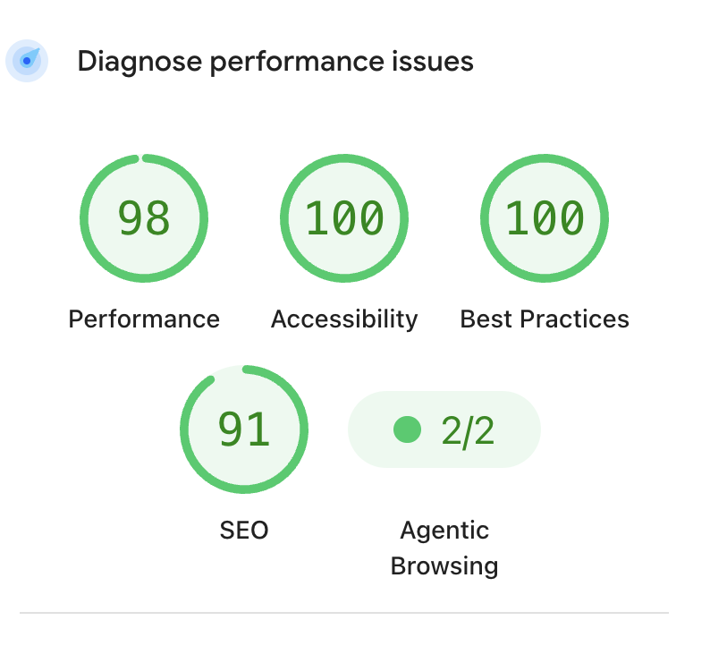

Performance - 98
    - The quickest fix to make would be to load a .webp instead of a .png file for my game but I don't think the impact would be that noticeable (est. savings of 720 KiB)
Accessibility - 100
Best Practices - 100
SEO - 91
    - The quickest fix would be to add a meta description that I will probably add later as part of the final project.

